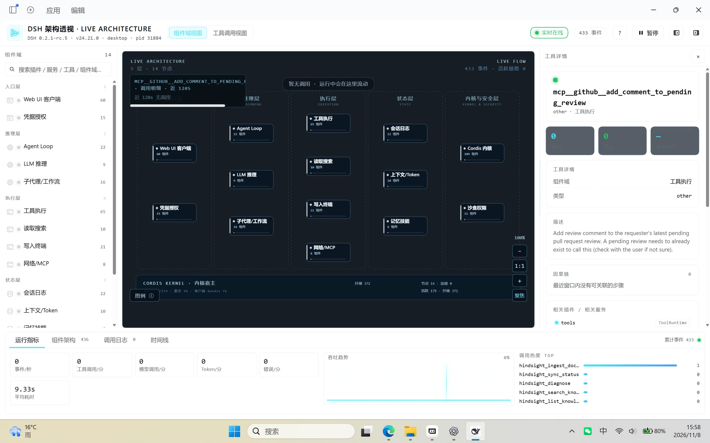
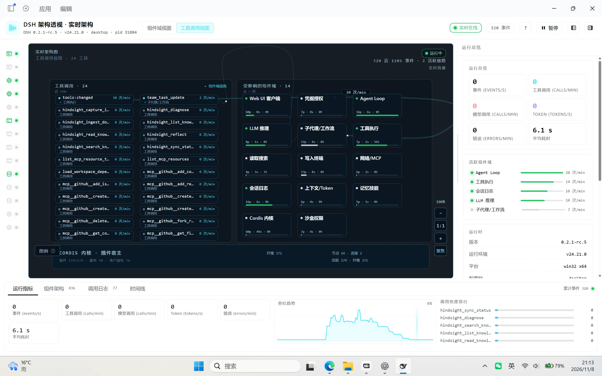

# dsh-anatomy · DSH 架构透视

> 把 DeepSeek Harness（DSH）的运行时画成一张实时分层架构图：插件、服务、工具、会话、模型与 MCP
> 都落在架构层里，运行时调用变成沿连线流动的光点。

## 一句话介绍

`dsh-anatomy` 是一个 DSH 插件（Host + Client 两部分）：在左侧栏加一个「架构透视」图标，
点击后在主区域打开整页 **DSH 架构透视 · 实时架构** —— 从左到右 5 层、14 个组件域的实时架构图，
以及底部的运行指标 / 组件架构 / 调用日志 / 时间线四个视图。

## 截图

组件域视图（5 层、14 个组件域的实时架构图）：



工具调用视图（Top 8 工具调用连线与受影响的组件域）：



## 安装

- **dshmarket（社区插件市场）**：插件 → 发现 → 搜索 `dsh-anatomy` → 安装（被收录后）。
- **GitHub 源码安装**：`dsh plugin add github:h2298511604-ops/dsh-anatomy`
- **npm**：`dsh plugin add dsh-anatomy`（[npmjs.com/package/dsh-anatomy](https://www.npmjs.com/package/dsh-anatomy)）

安装 / 更新后刷新页面一次（`Ctrl+R`）；左侧栏出现「架构透视」图标；若没有，确认插件已启用。
仓库即插件包（Host 与 Client 都是原生模块），无需构建步骤；卸载后路由、监听器、定时器与打开的流连接会随
`ctx.effect` 清理，不留后台定时器。

**打开方式**：

- **整页**：点击左侧栏「架构透视」图标（面板 id = `anatomy`）→ 主区域整页打开「DSH 架构透视 · 实时架构」；
  再点一次侧栏图标或切换到其他面板即可关闭。
- **右侧栏 tab（紧凑版）**：会话 header 工具区（与底部开关同排）的架构图标按钮（title「在右侧栏打开架构透视」），
  或右侧栏 guide 的「+」→「架构透视」；同一会话再次点击会聚焦 / 切回该 tab。左侧栏整页入口始终保留。
- 打开时先收到约 5 KB 的 **lite 快照**（14 个组件域计数 + 会话摘要），骨架立即消失、舞台先出；随后约 200 KB
  的全量快照到达后补全插件 / 服务 / 工具详情与连线；状态区会固定显示「首屏 xxx ms · 详情 xxx ms」。

## 它显示什么

### 分层架构图（5 层，左 → 右）

| 层级 | 组件域（id） | 职责 |
|---|---|---|
| 入口层 | Web UI 客户端（`skin`）、凭据授权（`immune`） | 页面渲染与交互入口；调用者识别、授权与遥测 |
| 推理层 | Agent Loop（`cortex`）、LLM 推理（`heart`）、子代理/工作流（`agents`） | 会话循环、模型推理与流式生成、子代理与工作流编排 |
| 执行层 | 工具执行（`stomach`）、读取搜索（`eyes`）、写入终端（`limbs`）、网络/MCP（`lungs`） | 工具注册表与执行管线；文件读取、搜索、图片；写入/终端/子进程；Web 与 MCP 通信 |
| 状态层 | 会话日志（`intestines`）、上下文/Token（`kidneys`）、记忆技能（`marrow`） | 会话日志与持久化；上下文压缩与 token 计量；技能、Hindsight、MCP 资源 |
| 内核与安全层 | Cordis 内核（`spine`）、沙盒权限（`liver`） | 插件纤维、服务容器、Loader、HMR、Web 宿主；沙盒、权限、审批与工具守卫 |

> 14 个组件域的 id 是 Host / Client 共用的协议键（Host 快照里仍叫 `organs` 字段），
> 卡片默认精简（技术名 + 组件数 + 状态点 + 细活动条），详细状态 / 活跃度 / 代表作在悬停或选中时以浮层显示。

### 节点、连线与光点

- 节点是圆角矩形卡片（细边框 + 状态点 + 技术名 + 组件数 + 细活动条；速率统一显示为「n 次/min」，
  代表作在悬停或选中时的浮层显示），把 Host 快照里的插件、服务、工具数量汇总到所属组件域；点击节点 → 右栏详情。
- **连线只来自真实观测到的调用**：按近 120s 的事件聚合出「来源 → 目标」边，只画实际发生过的调用；
  舞台右上角状态区显示 等待数据 / 运行中 / 已连接 · 空闲 / 已暂停 / 离线，按最近 15s 内是否有事件判定，
  并显示「最近事件：x 秒前」；无流量时一行小字提示「暂无调用 · 有调用时会在这里流动」，节点仍然可见。
- **连线是自然 S 曲线 + 轻量局部避障**：锚点按 |dx| ≥ |dy| 选择左右或上下边，控制点 = clamp(0.5 × 主轴距离, 40, 160)；
  若曲线与「非端点」组件卡片相交，则在局部候选（≤12：锚点对换 + 法向偏移 ±20 / 35 / 55 / 75）中挑选：
  目标是与卡片保持 ≥8 间距、不绕大圈（不做 gutter 通道），按相交长度 / 最小间距 / 路径长度打分；
  仍无完全避开的候选就取相交最少的一条。双向流量偏移 ±16、同向并行偏移 ±8；连线绘制在卡片之前，
  穿过卡片的部分被卡片遮挡；没有反向流量时只画真实观测到的那一条，不造线。端点沿卡片边界法向离开。
  连线标签为「n 次/min」（近 120s 调用次数），默认只在高频（≥5 次）或悬停 / 选中时显示。
- **方向由圆点表示**：每条有流量的连线用严格沿自身曲线移动的 SVG 圆点标示方向（源 → 目标）；
  圆点数量与速度随近 120s 调用量增大，事件发生时出现对应类型颜色的更亮圆点。点击连线 → 右栏「调用关系详情」。
- 圆点按调用类型着色：LLM=橙、工具=青、Session=紫、文件系统=蓝、审批=琥珀、错误=红、插件=品红；
  混合流量会按类型分布显示多种颜色的圆点。
- **Host 语义连线**：除工具 / 模型 / 会话事件外，Host 还会补画语义流——LLM 调用时的「上下文加载」
  （会话日志 → 会话循环）与「Token 计量」（模型调用 → 上下文/Token）、turn/end 的日志落盘（会话循环 → 会话日志）、
  compaction 回写（上下文/Token → 会话循环）；它们都来自真实观测事件，不是装饰线。
- **舞台背景保持纯净**：单色底 + 极淡点阵网格 + 5 个细虚线圆角框（1px dash）圈出层并带层名；
  节点卡片背后没有光圈 / 圆环 / 放射光等装饰。
- 舞台底部有一条 **CORDIS 内核 · 插件宿主**带：显示插件（活跃/总数）、服务数、客户端包数、
  纤维数，以及节点/连接数量。

### 指标与日志

- **运行指标**：事件 (events/s)、工具调用 (calls/min)、模型调用 (calls/min)、Token (tokens/s)、错误 (errors/min)、平均耗时（SI 格式，如 41 s / 312 ms）、吞吐趋势 sparkline、调用热度排行（数值来自 Host 约 60s 滚动窗口统计；排行与时序速率统一用 /min、/s 单位）。
- **运行总览**：runtime 信息（DSH 版本 / Node / profile / pid / uptime / origin）、连接诊断
  （API 基址、传输方式、已收帧、轮询次数、连接状态、主题 light/dark、最后错误）、活跃组件域排行。
- **调用日志**：实时表格（时间、类型、从 → 到、标签、耗时、状态），可过滤、可自动滚动，最多渲染最近 200 行。

## 页面结构

Header（标题 + DSH 版本/Node/profile/pid 副标题 + 视图开关 + 会话过滤下拉 + 连接状态点 + 事件计数 +
`?` 帮助 + 暂停/继续 + 折叠按钮）、左栏（14 组件域列表 + 全局搜索）、
中间舞台（分层架构图 + 移动圆点层；纯净背景：单色底 + 极淡点阵 + 层虚线框；右上角运行状态 HUD；
支持拖拽平移 / 滚轮缩放）、右栏（选中详情 / 运行总览，可拖拽调宽）、
底部四个 tab（运行指标 / 组件架构 / 调用日志 / 时间线）；另有会话右侧栏的紧凑版 tab（见下节）。

## 右侧栏「架构透视」tab（紧凑版）

除左侧栏整页入口外，架构透视还能作为会话右侧栏的一个 tab 打开（入口见「打开方式」），不离开当前会话即可查看：

- 顶部：标题「架构透视」+ **会话下拉**（默认跟随当前会话，可切「全部会话」或其他会话）+ **状态 pill**
  （运行中 / 已连接 · 空闲 / 已暂停 / 等待数据 / 离线 / 重连中）+「全屏」按钮。
- 「舞台（缩略）」：整张架构图的缩略版，点击组件域即可选中。
- 「全部组件域 · 14」：按 5 层分组的紧凑列表，每行 = 状态点 + 中文名 + 组成计数「Np · Ns · Nt」+「n 次/min」；
  点击一行展开该组件域的紧凑详情（描述 / 代表作 / 最近事件），再点收起。
- 底部：4 个指标（事件 (events/s)、工具调用 (calls/min)、Token (tokens/s)、平均耗时）+
  「最近调用 · <会话>」最近 5 条（类型 / 标签 / 时间；无调用时显示空态提示）。
- 首屏先渲染 lite 快照，全量数据未到时舞台角标显示「加载详情…」；连接中显示「正在连接 Host 数据流…」。

## 首屏与性能

- 打开面板时 Host 先推送约 **5 KB** 的 **lite 快照**（14 个组件域计数 + 会话摘要），骨架立即消失、舞台先出；
  随后约 **200 KB** 的全量快照到达后补全插件 / 服务 / 工具详情与连线。
- 舞台右上角状态区固定显示 **「首屏 xxx ms · 详情 xxx ms」** 两段耗时（首屏 = lite 帧渲染完成，详情 = 全量帧补全）；
  未测完时分别显示「首屏计时中… / 详情计时中…」，全量到达前舞台角标显示「加载详情…」。
- 底部四个面板等全量帧到达后再延迟一帧挂载，保证首屏绘制不被底部内容拖慢。

## 四个视图

### 1. 运行指标

- 关键指标卡：事件 (events/s)、工具调用 (calls/min)、模型调用 (calls/min)、Token (tokens/s)、错误 (errors/min)、平均耗时（如 41 s / 312 ms）。
- 吞吐趋势 sparkline：约最近 60 秒（120 采样点，随 metrics 帧节奏，活跃期采样更密）。
- 调用热度排行：按工具调用次数排序取前 5；无数据时显示占位。
- 状态点：`live` / `connecting` / `reconnecting` / `offline`；暂停只停止圆点动画与重绘，数据照收。

### 2. 组件架构

- 可搜索的完整清单：插件（按 bundle 分组、按状态排序、显示 fiberPhase）、服务（提供者/方法）、
  工具（调用数 / 平均耗时）、客户端包、模型、MCP 相关条目。
- 点选任意插件 / 服务 / 工具 / 组件域 → 右栏显示详情（来源、状态、描述、方法列表、最近事件、数据字段）。
- 顶部有过滤框，输入关键词即时过滤整份清单。

### 3. 调用日志

- 实时表格：时间、类型（带颜色 chip）、从 → 到、标签、耗时、状态（成功 / 失败）。
- 支持按标签 / 组件过滤，自动滚动开关；最多渲染最近 200 行；点行在右栏查看事件详情。
- 高频 token 流不会逐条刷屏：只累加计数与指标，不逐条生成日志行。

### 4. 时间线

- 支持「近 60s / 近 120s」窗口切换；每个 Session 一行泳道，横向按时间轴排布调用段，
  顶部显示「会话 N · 调用段 M」统计。
- 段类型：LLM 调用（`llm.start` / `llm.end` 顺序配对）与工具调用（按 `callId` / `rootCallId` 配对）；
  失败段标红，进行中的段显示为未闭合。
- 悬停调用段显示类型 / label / 耗时 / 时间范围 / 是否进行中；点击调用段 → 右栏详情；无数据时显示「暂无调用」。

## 交互说明

> 时间窗口：舞台连线、调用明细、上下游均按近 **120s** 统计；「运行指标」tab 的数值来自 Host 约 60s 滚动窗口。

### 视图切换

- 顶部「视图」开关在 **组件域视图**（默认：5 层架构图）与 **工具调用视图** 之间切换。
- 工具调用视图：左侧是 **Top 24 工具卡片**（面板标题「工具调用 · N」，显示 → 主要目标域与「n 次/min」速率）；
  右侧是 **14 个组件域的单列紧凑列表**（状态点 + 中文名 + 组成计数「Np · Ns · Nt」+ 近 120s 被调次数汇总）。
- 默认只画 **Top 8 有流量工具**的连线（无流量工具不画线）；面板右上角「显示全部连线 / 仅 Top 8」开关可切换，
  悬停 / 点击工具会高亮其连线并淡化其它元素；连线为平缓曲线，标签默认在 ≥2 次或悬停 / 选中时显示；
  点「← 组件域视图」返回；布局与行距已修，不与单位标签 / 内核带重叠。

### 按会话查看

- Header 的「会话过滤」下拉列出「全部会话」与快照 / 最近事件中出现过的各会话标题；当前活跃会话带「(当前)」标记。
- 选中某个会话后，舞台连线、近 120s 计数与各项指标、工具调用视图、调用日志、时间线、因果链都只统计该会话；
  下拉选回「全部会话」，或点右侧「×」（清除会话过滤）即可恢复全量。
- 右侧栏紧凑版默认跟随当前会话，也可在它自己的会话下拉里切换会话或「全部会话」。

### 图例（默认折叠为「图例 ⓘ」）

- 画布左下角常驻「图例 ⓘ」按钮，点击展开形状说明与圆点颜色说明；展开后点「×」（收起图例）折叠。

| 图例 | 含义 |
|---|---|
| 卡片 | 组件域 |
| 实线 | 调用关系 · 粗细 = 近 120s 调用量 |
| 连线标签 | 近 120s 调用次数（次/min） |
| 光点 | 实时调用（严格沿连线曲线移动，源 → 目标 = 方向） |
| 内核带 | 插件宿主 |
| 圆点颜色 | 调用类型：LLM=橙、工具=青、会话=紫、文件=蓝、审批=琥珀、错误=红、插件=品红 |

### 点击与悬停

- 点击组件域 / 工具 → 右侧查看详情；「组件架构」清单里的插件、服务、工具、客户端包、模型，
  以及「调用日志」中的事件行 / 「时间线」中的调用段同样可点选查看详情。
- 方向由严格沿自身曲线移动的圆点表示（源 → 目标）；圆点数量与速度随流量变化，颜色对应调用类型，事件发生时出现更亮的圆点。
- **点击调用连线** → 右栏「调用关系详情」：起止域、近 120s 次数、错误数、平均耗时、按来源 / 按类型明细、
  最近样本、相关服务 / 相关插件；并提供「在调用日志中过滤」（切到调用日志 tab 并按该来源过滤）与
  「查看起点域 / 查看终点域」跳转。
- 悬停 / 选中节点或连线时，无关元素淡化，突出相关调用；悬停组件域 / 工具节点时，舞台左上角显示
  「调用明细 · 近 120s」（该面板仅在 hover / 选中时出现；无调用时显示「近 120s 无调用」）。
- 右栏组件域详情包含「上下游」：上游 · 入边 / 下游 · 出边（对端 + 近 120s 次数，可点击跳选），
  以及「主要来源 / 工具」Top5。
- 关联跳转：服务详情显示「提供者插件」（点击跳到对应插件）与「查看组件域」；插件详情显示「它提供的服务」
  （点击跳到对应服务）。
- 右栏宽度可拖拽调整：拖动右栏左边缘把手（title / aria-label「拖拽调整详情栏宽度」），范围 272–420px
  （默认 clamp(300px,24vw,360px)）；窄屏（<900px）变为覆盖式抽屉。防溢出：长参数 / 结果用等宽滚动块展示，
  字段值最多 2 行省略号 + 悬浮看全文，内容区不横向滚动。
- 右栏详情为卡片化分区：标题 + 状态 chip、关键指标 stat 行、描述、所属域、相关插件 / 服务、因果链、最近调用，
  以及操作按钮「查看时间线 / 在调用日志中过滤 / 查看组件域」；工具详情展示「调用次数 / 错误数 / 平均耗时 / 最近耗时」，
  参数与结果（Host 提供时显示）、耗时 ms 与「耗时分布 · 近 120s」（最小 / 平均 / 中位 / 最大 + 迷你条形图）、
  相关 LLM 调用（同 session 最近 5 条，可点选）、令牌用量（输入 / 输出，Host 提供时显示）、时间戳、sessionId。
- 中文化：工具详情含「中文说明」（内置 59 个常用工具的中文说明；未知工具自动解析名称并标注
  「（自动解析名称，暂无内置中文说明）」）；「英文原文」默认折叠，点「展开英文原文」完整展开、点「收起英文原文」收起。
- 详情枚举中文化：纤维阶段（活跃 / 未激活 / 等待 / 卸载中 / 失败 / 未知）、插件类型（官方 / 第三方 / 本地 / 客户端）、
  工具类型（文件 / 终端 / 网络 / 代理 / 界面 / 检查 / 工具 / LLM / 会话 / 审批 / 插件 / 错误）、
  事件 data 键名（工具 / 调用 ID / 参数预览 / 结果预览 / 用量…等中文映射）。
- 右栏与底部指标栏的 Token 指标统一为「Token (tokens/s)」（数值按每秒显示）。
- **因果链**：选中工具调用或事件时，右栏按同一 Session 展示 用户消息 → 请求头 / LLM 推理 → 工具调用 →
  工具结果 → 助手回复 → 回合结束 的纵向步骤（相对时间、耗时、状态色、可点选）；
  数据不足时显示「仅显示最近窗口内可见步骤」。
- 空态提示与调用明细等悬浮信息贴在舞台顶部 / 边角，不遮挡组件卡片；节点浮层在边缘会自动翻转夹紧。
- 选中态为静态描边 +「已选中」角标（无旋转/动画），便于与悬停高亮区分。

### 舞台缩放与平移

- 画布右下角有缩放控件：显示当前缩放百分比，「−」缩小、「1:1」重置视图、「＋」放大、「聚焦」聚焦选中项。
- 滚轮缩放以鼠标位置为锚点（步长 1.12，范围 0.6–3）；键盘 `+` / `-` 缩放、`0` 重置。
- 滚轮在右栏 / 调用明细 / 图例 / 时间线等区域只滚动、不缩放（仅在舞台图上滚轮才缩放），不会误触发。
- 按住左键拖拽可平移视图（grab / grabbing，4px 阈值避免误点节点），平移限制在内容范围附近，与缩放、重置、聚焦共存。

### 帮助与暂停

- Header 右侧的 `?` 按钮打开「交互说明 · 图例与操作」弹窗；按 `Esc` 或点击弹窗背景关闭。
- 暂停只冻结动画与圆点，数据继续接收；恢复后继续播放。

### 主题与选中

- 右栏与底部总览卡片的表面色跟随宿主主题 token 自动适配：浅色主题为白底、深色主题为深色；
  舞台架构图保持深色 HUD 风格。
- 点击舞台空白处取消选中（右栏回到运行总览）；按 `Esc` 取消选中，同时关闭「交互说明」弹窗。

### 状态色

| 状态 | 颜色 | 含义 |
|---|---|---|
| 活跃 | 绿 | 正在工作 |
| 待机 | 灰 | 已加载但空闲 |
| 警戒 | 琥珀 | 有错误或降级提示 |
| 异常 | 红 | 调用失败 / 错误 |
| 离线 | 灰 | 不可用或未连接 |

## 数据从哪来

- **Host 侧**（`index.js`）：`inject = ['webServer']`，在裸 Web 服务器上注册 4 个 exact GET 路由；
  其余服务（tools / agents / sessions / loader / clientModules / llm / …）全部通过 `ctx.get(...)` 可选读取，
  取不到就省略，绝不让快照失败。
- **只读旁路采集**（重要）：
  - Cordis 拓扑：`ctx.registry` / `ctx.loader.entries()` / `ctx.reflect.store` / `ctx.clientModules.graph()`；
  - 运行事件：以 `{ global: true }` 监听 `tools/execute`（waterfall 包裹）、`llm/stream`、
    `session/event`、`agent/*`、`approval/request`、`fs/observed`、`plugin-manager/*`、`hmr/reload` 等。
  - 所有监听器都有 try/catch；waterfall 监听器必须把 `next()` 的结果原样返回，**不修改参数、不改变返回值**；
  - 不写会话、不写配置文件、不改变工具/模型/会话行为，只做观察。
- 高频事件（token delta、assistant-stream 等）**不**逐条转成 TraceEvent，只累加计数器并影响活跃度。
- 事件保存在 Host 内存 ring buffer 中（容量 4000，`eventsTotal` 单调递增）；进程重启或页面刷新后重新积累；
  `after` 小于缓冲区起点时返回 `reset:true`，客户端自动全量重拉。
- 工具指标由 Host 聚合：calls / errors / avgMs / minMs / maxMs（「耗时分布 · 近 120s」的数据来源）。
- 工具 → 组件域映射已补全：MCP / 网络工具 → 网络/MCP、Hindsight / 技能 → 记忆技能、session 工具 → 会话日志、
  代理 / Agent Team / 工作流 / 定时 → 子代理/工作流、工作区 / 终端 → 写入终端、goal / todo → 会话循环、
  present → Web UI 客户端、cordis / lsp → Cordis 内核；未知工具默认归入 Cordis 内核（不再因自环丢线）。
- **Client 侧**（`client.js`）：优先 `fetch` + `ReadableStream` 逐行解析 NDJSON 长连接
  （基址优先 `window.__DSH_TRANSPORT__.streamBaseUrl`，否则按页面相对路径解析）；
  流不可用时退化为每 1200ms 轮询 `/api/events?after=`；连续失败显示 `offline` 并按 1s/2s/5s/10s 递增退避重连。
  另有「已连接但长时间无帧」的缓冲型代理 watchdog、`truncated` 快照自动补拉 `/api/snapshot` 兜底。

## HTTP 接口

所有接口都是 Host 在 Web 服务器上用 exact 路由注册的 **GET** 接口，前缀固定 `/dsh-anatomy`，
返回 `Cache-Control: no-store`（同源，不设 CORS 头）。

| 方法 | 路径 | 说明 | 关键字段 |
|---|---|---|---|
| GET | `/dsh-anatomy/api/ping` | 安装自检 | `ok:true`、`plugin:'dsh-anatomy'`、`schemaVersion:1`、`uptimeMs` |
| GET | `/dsh-anatomy/api/snapshot` | 完整快照 | `ok`、`schemaVersion:1`、`generatedAt`、`seq`、`runtime`、`organs[14]`、`plugins`、`services`、`tools`、`agents`、`models`、`bundles`、`clientBundles`、`topology`、`counts`、`live`、`orgMetrics`、`toolMetrics` |
| GET | `/dsh-anatomy/api/events?after=<seq>&limit=<n>` | 轮询增量 | `ok`、`seq`（轮询游标=本页最后一条事件 id）、`reset`、`events[]`、`metrics`、`orgMetrics`、`toolMetrics`、`snapshotChanged` |
| GET | `/dsh-anatomy/api/stream` | NDJSON 长连接 | 每行一个 JSON：`hello` → `snapshot`（lite，~5 KB：14 域计数 + 会话摘要，先渲染首屏）→ `snapshot`（全量，~200 KB）→ 每 ~2s 推 `metrics` 帧（运行指标/sparkline 数据源）→ 有事件时约 250ms 一帧 `events`；拓扑变化推 `snapshot`；空闲 15s 推 `ping` |

非 GET 请求返回 `405`；其他路径不注册 fallback。handler 内部全部 try/catch，异常时返回
`{ok:false,error:<message>}` 且不冒泡。

事件 `data` 还携带可选字段（缺失时界面自动隐藏）：`tool.end` → `argsPreview` / `resultPreview`；
`llm.end` → `usage`（`inputTokens` / `outputTokens`）。

```bash
# 默认 origin 是 http://127.0.0.1:64724
curl http://127.0.0.1:64724/dsh-anatomy/api/ping
curl http://127.0.0.1:64724/dsh-anatomy/api/snapshot
curl "http://127.0.0.1:64724/dsh-anatomy/api/events?after=0&limit=50"
curl -N http://127.0.0.1:64724/dsh-anatomy/api/stream
```

## 故障排查

### `ping` 不通

1. 先确认 DSH Web 正在运行，且浏览器地址的 origin 与预期一致（默认 `http://127.0.0.1:64724`，
   反代场景请用实际 origin 或带前缀的地址）。
2. 确认 `dsh-anatomy` 已安装并启用；DSH 版本是否在兼容范围内（见下）。
3. 404：路由未注册 → 插件未激活或 Host 部分加载失败，查看 DSH 日志 / Plugin Manager 中的 fiber 状态。
4. 连接被拒：DSH Web 未启动，或端口/代理配置不对。

### 页面能打开但没有数据

1. 按 `Ctrl+R` 刷新页面；观察首帧是否到达（状态点应从 `connecting` 变 `live`）。
2. 打开 DevTools → Network，直接访问 `/dsh-anatomy/api/snapshot` 看返回是否正常（14 个组件域、plugin/service 列表非空）。
3. 若宿主刚启动、插件尚未加载完，稍候片刻或刷新一次即可。
4. 若 Console 有 slot / 组件报错，记录错误信息并反馈（Client 有 ErrorBoundary，崩溃时不至于白屏）。

### 连接显示 `offline`

1. 反向代理可能会缓冲流式响应 → Client 会自动退化为 1200ms 轮询 `/api/events`，功能不受影响。
2. DSH 重启或 HMR 后，Client 会按 1s/2s/5s/10s 递增退避自动重连。
3. 长时间 offline：检查浏览器是否能访问 `/dsh-anatomy/api/ping`，以及页面是否有网络/权限拦截。

### 开发者自检

- 语法检查：`node --check index.js && node --check client.js`。
- 接口自检：`GET /dsh-anatomy/api/ping` 返回 `ok:true`；`GET /dsh-anatomy/api/snapshot` 中
  `schemaVersion` 为 1 且 `organs` 为 14 项。
- Host 集成：可在本地用假 Cordis `ctx` 调用 `apply()`，断言 4 条 exact 路由、快照字段与清理逻辑；
  该集成 harness 不随插件包发布。

## 隐私说明

- 只采集**调用元数据**：工具名、耗时、成功/失败、参数 / 结果预览（JSON.stringify 截断 160 字符）、
  模型 provider/model/tokens 用量、会话事件类型与少量精简字段、插件/服务/纤维拓扑。
- **不采集**消息正文、文件内容、凭据/密钥明文；不落盘、不上传、不发起任何外网请求，也没有遥测。
- 事件只存在于 Host 进程内存的 ring buffer（最多 4000 条），进程退出即消失；快照按需在内存中拼装。
- 全部为只读旁路观察：不写会话日志、不改配置、不改变工具/模型/会话行为。

## 兼容性与许可

- **DSH 0.2.x**（已在 0.2.1-rc.5 实测）；Host（`index.js`）与 Client（`client.js`）随同一插件包发布，无需分别安装。
- **Node.js ≥ 20**（与 DSH 运行时一致）。
- 无第三方运行时依赖：Host 仅使用 Node 内置模块与 Cordis `ctx`，Client 仅使用平台内置的 `react`。
- 快照/接口 `schemaVersion: 1`，与当前实现契约一致；跨版本变更会提升版本号。
- 右栏与底部总览卡片的表面色跟随宿主主题 token 自动适配（浅色主题白底 / 深色主题深色），舞台架构图保持深色 HUD。
- 浏览器需支持 `fetch` + `ReadableStream`（Chrome / Edge / Firefox / Safari 近两年版本）；
  不支持流式读取时自动退化为轮询。
- **License：MIT**（见 [LICENSE](LICENSE)）。
- 仓库：<https://github.com/h2298511604-ops/dsh-anatomy> ·
  问题反馈：<https://github.com/h2298511604-ops/dsh-anatomy/issues> 。

## 版本

- 当前版本：**1.0.0**
- 图标 `icon.svg` 为本项目自绘原创 SVG（256×256）：深色圆角 HUD 面板 + 分层节点卡片与发光连线 +
  流动光点 + 右上活动脉冲 + 细网格；无外部引用/脚本/字体/位图，可随包分发。

## English summary

`dsh-anatomy` is a DSH plugin that renders the running DeepSeek Harness as a live architecture map:
five layers, fourteen component domains, and the real tool/model/session call flow drawn as moving
dots along observed edges over the last 120 seconds. It adds an "Architecture" (架构透视) icon to the
sidebar that opens a full-page HUD with four views — runtime metrics, component architecture, call log
and timeline. It can also open as a compact tab in the conversation right sidebar (session-header
architecture button or the right-sidebar guide), and the full view can be filtered to a single session.
All data comes from read-only side-channel observation of Cordis topology and
tool/model/session events; it never mutates tool behaviour, sessions or user data, and keeps events in
memory only. Install it from the community market (when listed) or with
`dsh plugin add github:h2298511604-ops/dsh-anatomy` (`dsh plugin add dsh-anatomy` after the npm
release), then reload the page once. Requires DSH 0.2.x and Node.js ≥ 20; MIT licensed.
